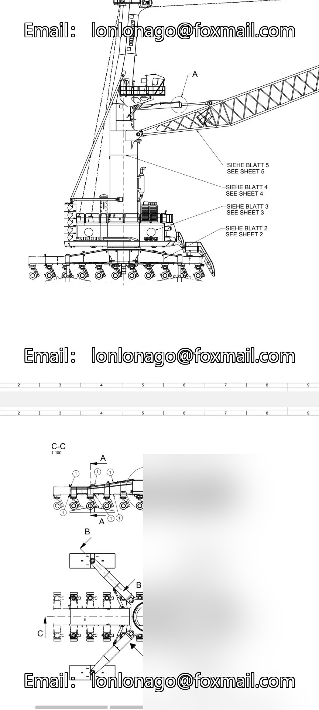
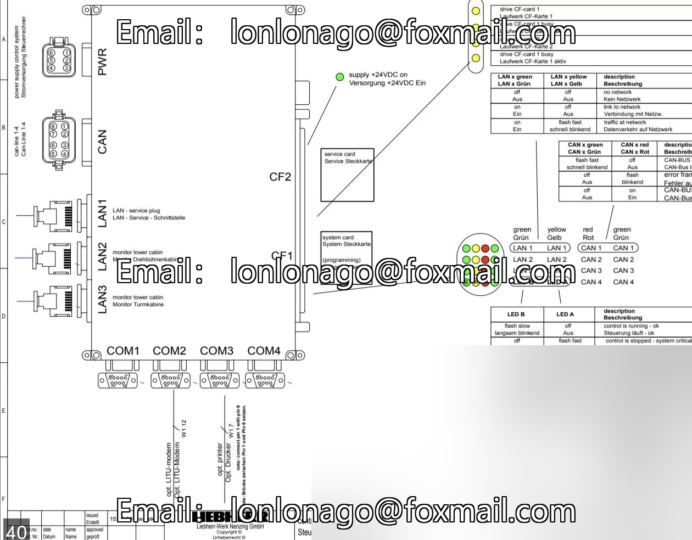
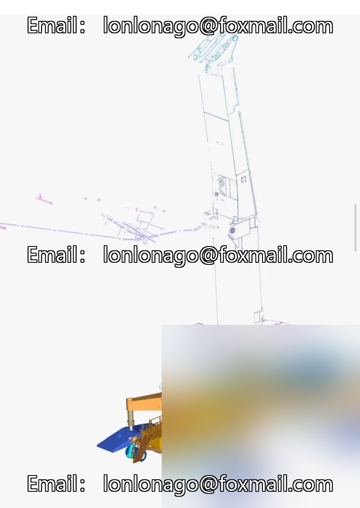
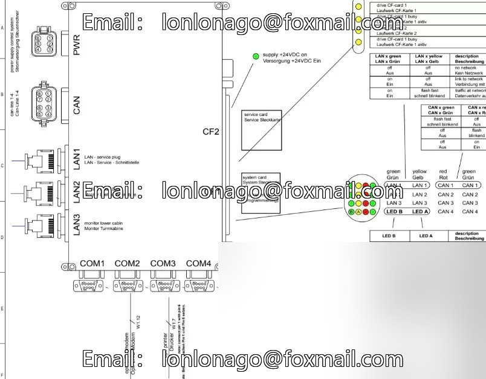
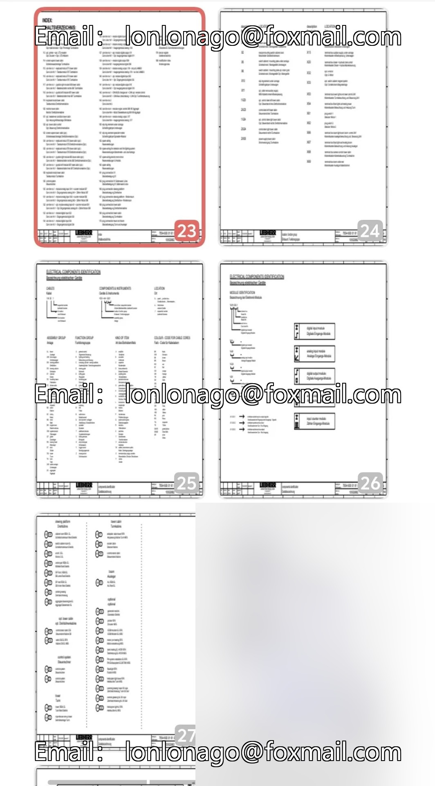

# Liebherr (Liebherr) mobile crane LHM 550 technical

## Body

Technical documentation for Liebherr (Liebherr) mobile crane LHM 550, . 340 pages.
Professional: suitable for learning reference of mechanical engineering, crane technology, and equipment maintenance.
826806598
no return, no exchange after sale.
Need to directly photograph, chat privately if there are issues.

The technical documentation covers the Liebherr LHM 550 mobile crane, comprising 340 pages, and is suitable for reference in mechanical engineering, crane technology and equipment maintenance.

<!-- AI_ENRICHED -->

## Images

## Payment

Here is a pay link on Stripe ( https://buy.stripe.com/3cs8yP7sY87d0vu9AB ). Please contact me lonlonago@foxmail.com after funding $89, and I will send you a complete data files , thank you!

